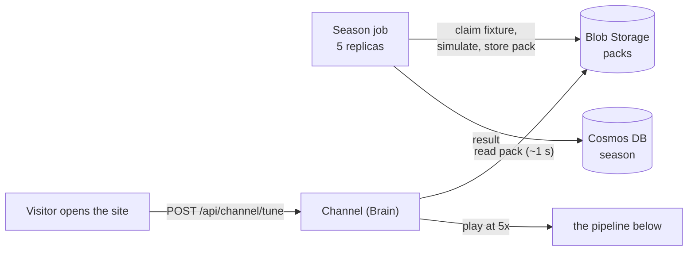
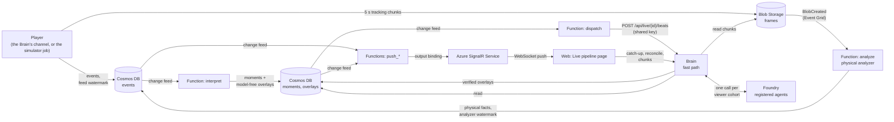

# The live pipeline

Two live paths share the same stages (analyse, detect moments, write verified stories) and the same code:

* **Streams** (what **Live** in the menu uses): one viewer, one match, played in the Brain's process with that viewer's own clock. See [Streams](#streams-the-same-stages-in-one-process).
* **The event-driven path** (the *Cloud pipeline* page, `#pipeline`): a Container Apps Job plays the match into Cosmos DB and Blob Storage and Azure carries it through Event Grid, Functions, the Brain and SignalR,
  as described under [The pipeline](#the-pipeline). It runs one match at a time and is the cloud-native reference for the stages.

The older "channel and season" design (a 30-match season simulated ahead of time into packs, one shared channel on the home page) is still in the Brain's code and API
([brain-api.md](brain-api.md)), but no page of the web app uses it any more (its pages were removed). It is kept below for reference only.

## The channel and the season (not used by the web app)

* **Packs** (`live/packs.py`). A finished simulation stored once: the metadata, the full event list, and the tracking as the compact bundle the replay packages use (about 2 MB a
  match; a season is about 60 MB in the `packs` blob container, not in the repository). From a pack the player builds the feed documents and the tracking chunks, byte for byte what
  `build_feed` / `build_chunks` give from the simulation (`tests/test_packs.py`); chunks are cut and encoded when they are due.
* **The season** (`live/season.py`). Six clubs, home and away: 30 fixtures in 10 rounds, **round 1 being the three demo matches** (Redmoor v Saltmarsh with the red card, Harbour v
  Northbridge with the pressing collapse, Kestrel v Aldergate with the eight-goal thriller). Fixtures, results and the table live in the `season` Cosmos container.
* **The season job** (`live/season_job.py`, Container Apps Job `caj-<env>-season`, 5 replicas). The replicas are not told which fixtures are theirs: each **claims** the next pending
  one (an atomic change of its status guarded by the document's etag; an abandoned claim expires after five minutes), simulates it, writes the pack and records the score, until none
  is left. **The whole 30-match season took about two and a half minutes** on 1 vCPU replicas (see "Measured"). *Simulate a new season* on the Season page starts it; the site
  switches to the new season at once and its table and fixtures fill in as results arrive.
* **The channel** (`live/channel.py`). `POST /api/channel/tune` joins the match that is on air or starts the next fixture: it reads the pack and a thread of the Brain plays it with the same loop
  the simulator job uses. Every viewer shares one match, like a broadcast. A heartbeat says the player is alive; when the last viewer leaves the Brain scales to zero and the match
  stops with it, and the next visitor finds a stale heartbeat and starts the next fixture. At full time the page asks for the next one after a 10 s break (the first to ask starts it,
  the others join); **Next match** skips. Asking for a fixture on the Season page takes the match on air off (its player stops) and plays that one.
* **The table "as broadcast".** The home page's table counts only fixtures that have been played on air to the end, so it does not spoil the match you are watching; the Season page
  shows the whole simulated season and marks the fixtures you have seen.
* **What a visitor sees on arrival.** The page wakes the Brain if it is asleep (about 20 s with a cold container, the usual scale-to-zero price), tunes in, and shows the pitch as soon
  as the first tracking chunks are there: a few seconds more. If the season has not been simulated yet (a fresh deployment) the first visit plans the default season and starts the job,
  and the page says so while its first match is simulated.

## The pipeline

| Stage | Where | Code | What it does |
|---|---|---|---|
| **Feed** | The channel's player thread in the Brain (from a pack); or the Container Apps Job `caj-<env>-sim` for an ad hoc match (`POST /api/live/start`) | `live/channel.py`, `live/feed.py`, `live/simulator.py` | Releases the match at `speed` times real time: the **events** into Cosmos DB (after each batch it states the *feed watermark*: every document up to that match time is written) and the **tracking** as five-second chunks into Blob Storage. A late start (`--from-minute`) publishes the part already played at once. |
| **Analyze** | Function `analyze` (Event Grid trigger on blobs created in `frames`) | `apps/functions/function_app.py`, `live/analysis.py` | The physical analyzer (sprints, top speed, distance, team shape, pass and shot context) as an event-driven worker. It drains the chunks in order under a lock, writes the physical documents, **then** states the *analyzer watermark*. |
| **Interpret** | Function `interpret` (Cosmos DB change-feed trigger on `events`) | `live/pipeline.py` | Reads only the documents it has not seen, up to the lower of the two watermarks, in arrival order; stores the new **moments** and the overlays that need no model. |
| **Dispatch** | Function `dispatch` (change-feed trigger on `moments`) | `apps/functions/function_app.py` | Asks the Brain to write the narrative overlays for the new moments. |
| **Explain** | The Brain, `POST /api/live/{id}/beats` | `live/dispatch.py`, `agents/` | The same fast path as `/api/beats`: the Editor, the cache, one model call per viewer cohort, the Verifier, the template fallback. Overlays are stored in Cosmos DB. |
| **Push** | Functions `negotiate` and `push_overlays`, `push_moments`, `push_events` (change-feed triggers with the SignalR output binding) | `apps/functions/function_app.py` | The browser negotiates a connection to Azure SignalR (serverless mode, Microsoft Entra authentication, no keys); every overlay, moment and event that is stored is pushed to it in batches. |
| **Show** | The Brain's read API and the web page | `live/api.py`, `web/src/components/PipelinePage.tsx` | Catch-up (`GET /api/live/{id}/feed`), the match's metadata, the tracking chunks (the Brain serves them: the storage account is private), and a slow reconciling poll while push works. The Cloud pipeline page shows each stage as it happens; **Live** itself uses a stream (above), not this path. |
| **Safety net** | Function `sweep` (timer, every 30 s) | `apps/functions/function_app.py` | For each live match, does what the triggers would have done: drain the chunks, interpret. A lost Event Grid event or a restarted instance cannot stall a match for long. |

## Why it is built this way

* **Event time and watermarks.** Two producers (the job's events, the analyzer's physical facts) feed one interpreter, and the physical facts for a stretch of the match are
  only known some seconds after the stretch itself. The interpreter must see a fixed order whatever the order of production, or the moments it finds and their ids would
  depend on timing. So each producer states a **watermark** (everything up to this match time is written) and the interpreter only consumes up to the lower of the two.
  The analyzer writes its documents first and the watermark after, and a physical document is never emitted more than one chunk (5.2 s, measured on all three scenarios)
  after its own match time, so after chunk *k* everything up to the chunk's end minus 6 s is complete.
* **Incremental, with recovery.** The interpreter and the analyzer keep their state in memory while the instance is warm and checkpoint it to blob storage (every 20 s;
  every 30 chunks) so that a cold instance restores and carries on. A checkpoint is a pickle, so it is **signed** with an HMAC of the shared key and ignored if the signature
  does not verify (and checkpointing is off when no key is configured). Replaying from a checkpoint re-reads documents already seen; ids are deterministic and everything is
  created only if absent, so replaying changes nothing.
* **At-least-once everywhere, so everything is idempotent.** Event Grid and the change feed deliver at least once and in no particular order. The analyzer's `analyze`
  does not process "the chunk in the event": it processes **the next chunks in order, as many as exist**, under a lock with an expiry (a crashed holder cannot block it),
  and looks once more after releasing the lock so that a chunk that arrived at the wrong moment is not forgotten. The Brain scales to zero and may be asleep for the first
  dispatch (it retries).
* **The live and the batch pipeline are the same code.** `tests/test_live.py` plays a match through the real playback loop on a fake clock, calling the workers as the triggers
  would, and checks that the analyzer worker produces exactly the documents the sequential analyzer produces over the same chunks, that the interpreter finds the batch
  pipeline's moments, that cold workers restoring from checkpoints give the same result, that a planted unsigned checkpoint is ignored, that the interpreter waits for the
  slower watermark, and that concurrent invocations do not run at once.
* **The live analyzer sees what a provider delivers.** Chunks carry positions rounded to 0.1 m, so the physical numbers derived from them differ slightly from the recorded
  replays' (which were analysed from the simulator's raw floats). The tests compare the worker with the analyzer run over the same rounded chunks.
* **Narrative overlays are written by the Brain, not by a Function**: the Brain already holds the agents, the cache and the Foundry connection, and a model call is I/O, not
  compute. The Function only decides *when*.
* **The job runs the Brain's image** with another command, so the simulator, the interpreter, the analyzer and the agents are one code base.

## Speed, delay and what the viewer sees

`LIVE_SPEED` (default 5) is the number of match seconds per real second. A match of 95 minutes then takes 19 minutes; starting at minute 40 takes 11. The delay between a
moment happening and its overlay being stored is real time, so in match time it is multiplied by the speed: that is why the default is 5 and not 60.

The page does not show the live feed: it shows the match `LIVE_DELAY_S` (25) wall seconds behind it, the way a broadcast runs behind the match. That is the time the pipeline
needs to write what the viewer is about to see, and it also gives the tracking chunks (published when they are complete) time to arrive. Everything on the page (the pitch, the
score, the events, the overlays) follows that one playing clock.

## Using it

* In the web app: just open it. **Season** shows the table and fixtures and **Simulate a new season**; **Replays** is the recorded match center (`#/replay`); **Next match** skips the
  match on air. The Brain starts the season job through Azure Resource Manager with its own identity (Contributor on that one job and nothing else).
* Over HTTP (see [brain-api.md](brain-api.md#live-pipeline)): `POST /api/channel/tune`, `GET /api/season`, `POST /api/season/simulate`, then `GET /api/live/{id}/feed`, `/meta` and
  `/chunks/{n}`; `POST /api/live/start` still starts an ad hoc scenario through the simulator job.
* Simulating a season from a laptop: `uv run python -m matchmind.live.season_job --season season-2 --create --seed 2 --make-current --workers 8` (needs the Cosmos DB and Blob Storage environment variables, since the processes share the work through them).
* On a laptop, without Azure: `uv run python -m matchmind.live.simulator --scenario red-card-drama --speed 50` plays the match into memory and runs the analyzer and the
  interpreter in the same process after each tick; with `MATCHMIND_LIVE_LOCAL=1` the Brain's start endpoint does the same in a thread. There is no dispatch or push locally (they need
  the Brain's agents and Azure SignalR).
* Starting the job by hand: `az containerapp job start -g rg-matchmind -n caj-matchmind-sim`.

## Protection

* `POST /api/season/simulate` is public but limited: two a minute per client and one season being simulated at a time (the second caller is told which). `POST /api/channel/tune` is
  limited to 20 a minute per client and accepts only speeds of 5, 10 and 20. `POST /api/live/start` (the ad hoc simulator job) is limited to three a minute, one live match at a time, scenarios from a fixed
  list; a job that never began playing stops holding the slot after ten minutes, and a failed start releases it at once.
* `POST /api/live/{id}/beats` spends model tokens, so it needs the shared key (`x-live-key`, `MATCHMIND_LIVE_KEY`, set on the Brain and on the Function app) and
  **fails closed**: with no key configured nobody gets in, unless `MATCHMIND_LIVE_OPEN=1` marks a development machine.
* The read endpoints (feed, metadata, chunks) are limited to 240 requests a minute per client. Chunks are immutable and cacheable.
* The Function app's CORS lists the web app's origins only; SignalR, Cosmos DB and Blob Storage are reached with managed identities (no keys; shared-key access to the storage
  account is off).

## Measured

All on Azure, October 2026, `gpt-6-luna` through the registered agents, 5x speed, one match and one viewer at a time.

**Simulating a season.** 30 fixtures, 5 replicas of 1 vCPU, started from the Season page's button: the first result about 50 s after the click (a container starting, then a
simulation), the last about 140 s after it. Each fixture took 18 to 19 s to simulate and store on a replica. A single replica would need about 9 minutes: the claim-based design
turns the parallelism into a setting.

**Opening the site.** With the Brain warm the pitch was on screen with a match at kick-off within 10 to 12 s of loading the page, without any click. With a cold Brain add the
container start (about 20 s). Starting a fixture is a pack read of about a second; the 45 s the earlier version spent simulating while the viewer waited is gone.

**A match through the pipeline** (the red-card story, 11 minutes of wall time, run on the previous version of the home page; the pipeline is the same):

| | Result |
|---|---|
| Moments the interpreter found | 15 (7 of them after the start of the run) |
| **Delay from a moment being detectable to its first overlay being stored** | **median 9.6 s, 90th percentile 13.3 s, from 9.0 s to 13.3 s** over the 7 moments |
| of which detecting the moment (feed, analyzer, interpreter) | median 3.8 s, at most 6.8 s |
| of which writing it up (dispatch, the Brain, the model, the Verifier, the store) | median 6.1 s, at most 6.5 s |
| Narrative overlays (lower thirds, all cohorts) | 120: 91 written by the model, 29 template (the model call missed the then 6 s deadline) |

The first version of the pipeline (replaying the whole match from the store on every change-feed batch, no push) measured a **median of 19.8 s with a worst case of 51 s** on the same
scenario; the incremental interpreter with watermarks, the Event Grid analyzer and the push removed that. After the run the dispatcher's deadline was raised to 12 s (nobody waits on it:
viewers watch 25 s behind the feed), which should lower the template share; **that was not re-measured over a whole match**.

Read this carefully:

* The delay is **real time**: at 5x a delay of 10 s is 50 s of match time, which is why the speed is not higher.
* Seven moments in one match is a small sample, and one scenario.
* Catch-up after a late start was the weak point: the first analyzer processed about 10 match-seconds per wall second; after prefetching chunks, buffering events and writing documents in
  parallel it keeps within about 10 match-seconds of the live feed. The channel starts matches at kick-off, so it does not need it.

## Streams: the same stages in one process

The Azure path above spends its time on hops: the feed in Cosmos DB, the Event Grid event, the Function, the change feed, the dispatcher. A **stream session**
(`live/session.py`) runs the same incremental stages with the stages called directly, in the Brain's process, against an in-memory store:

    play()  ->  AnalyzerWorker.drain()  ->  InterpretWorker.run()  ->  write_beats()  (the fast path, for the viewer's cohort)

* **One match per viewer.** `POST /api/stream {demo, speed, fromMinute, cohorts}` answers at once; the demo is simulated once and kept (preloaded at boot), and the session's own
  store holds only what the session's clock has reached, so nothing from a viewer's future is ever in their store. There is no shared live match and no one-at-a-time limit; the
  Brain caps matches being played at once (`MAX_SESSIONS`, 12), stops a match whose viewer stopped polling (5 minutes) and frees a finished one after 15.
* **Physical facts from a video feed.** The analyzer of a stream session does not read the provider's tracking but what a video model rebuilt from rendered video of it
  (`vision/`, [vision.md](vision.md)): frames are rendered, a detector finds the players and the ball in the pixels, a tracker turns them back into tracking chunks. If
  the video model falls more than three chunks behind (a fast match, a busy server) the next chunks are the provider's tracking and the model starts again after them.
  `STREAM_VISION=0` switches it off. A viewer who joins mid-match gets the earlier chunks from the provider and the video model from the join point.
* **Capacity.** Per viewer, a live match costs almost no CPU once the video model's reading of the demo exists (it is read once per demo and shared, and can be baked
  into the image): measured locally, 1, 3 and 6 viewers of the same demo cost the same total. What each viewer still pays for is the narrative (model calls, shared
  through the beat cache when the moment and viewer type are the same) and serving the feed (about 1-2 ms a poll). The Brain still holds each match in memory, so it
  takes at most twelve at once on one replica. Measured on Azure, from one client, with each viewer polling the feed every 0.7 s: five viewers at 5x or six at 10x, no errors, feed polls median 220 ms and worst 366 ms (an idle `/health` call from the same place is 217 ms, so that is the round trip); twelve viewers staggered 11 s apart at 5x, 1 108 polls, median 221 ms, p95 0.7 s. The only slow answers were the first starts of a demo right after a restart, while the Brain was still building it (about 30 s). In the browser, the 3D pitch lowers its pixel ratio and then its frame rate when frames take too long (several live tabs
  share one GPU), and a hidden tab stops asking for video frames.
* **Speed can change while it plays.** `POST /api/stream/{id}/speed` (1, 5 or 10): the player re-anchors its clock where it stands, so the match carries on from the same minute.
  The picture holds for a few seconds when the match speeds up (the delay is in wall seconds, so it needs a longer lead) and runs a quick catch-up when it slows down.
* **Ask the match, so far.** `POST /api/ask/live` answers from an interpreter rebuilt from only the documents that had arrived by the viewer's position (and never past the
  match clock), so the planner's tools cannot read what has not happened. A probe on Azure (red card at minute 45, match clock at minute 4, position forced to minute 133) answered
  from minute 4 and did not mention it.
* **Text for the person watching.** The model writes the narrative overlay for the session's cohorts (the viewer's profile; a second one in split view; `POST /api/stream/{id}/cohorts`
  adds the profile a viewer switches to, for the moments still to come), not for all eight cohorts of a replay package: one model call per moment instead of eight, and no
  waiting for the slowest of eight. Identical moments of a demo have identical ids, so the Brain's beat cache shares model text between viewers.
* **The numbers while the match is on.** The whole analytics summary (win probability, shots and xG, possession value, networks, shape, space, phases, players) is recomputed from the
  session's interpreter every 4 s (it costs 0.03-0.05 s) and sent to the viewer only when it is newer than theirs, so the win-probability bar, the tactics panel and the Explore workspace
  fill as the match goes. The preview recap is written at kick-off, the half-time recap when the interpreter passes the break and the full-time recap at the end, for the viewer's mode,
  language and club. The Recap Writer produces the headline and summary (`RecapText`); the key moments, figures and player of the match are the evidence pack's, true by construction.
* The endpoints are the live ones under `/api/stream` (`feed`, `meta`, `chunks/{n}`, `DELETE`), so the viewer code is shared; see [brain-api.md](brain-api.md).

Measured on a laptop against the deployed Foundry project (`gpt-6-luna`, registered agents), the red-card demo at 10x from minute 40, one viewer; delays are real time from the
moment becoming detectable (the match clock reaching its `detectedAt`) to the event:

| | Azure path (above, 5x) | Stream session (10x) |
|---|---|---|
| Moment found by the interpreter | median 3.8 s | **median 1.6 s**, at most 2.4 s |
| First narrative overlay stored | median 9.6 s, 90th percentile 13.3 s | **median 5.5 s**, at most 6.9 s (five moments, all model-written) |
| Starting a match | a pack read (about 1 s), 20 s more on a cold Brain | 0.03 s once the demo is loaded |
| With eight cohorts instead of the viewer's one | n/a | median 9.0 s, at most 11.8 s |

**Ten viewers at once** (laptop, `gpt-6-luna`, three demos, 10x from minute 40, ten different profiles, 90 s): 43% of a core; a feed poll took a median 11 ms (95th percentile 38 ms,
slowest 191 ms); moments were found a median 1.3 s after they became detectable (90th percentile 2.4 s) and the narrative overlay arrived a median 6.6 s after (90th percentile 8.2 s,
slowest 13.0 s; 22 of the 25 moments of the run had theirs by the time it ended). All ten viewers polled from one address, so the Brain's own limit per address (now 900 requests a
minute for the stream endpoints; one viewer uses about 200) answered 429 to part of the polling: the test counts that, the numbers above are from the polls that were answered.

Cost of a session: about 7% of a core at 10x (5 sessions at 10x: 34% of a core, 336 MB against 220 MB idle, about 25 MB each). Five moments is a small sample and one demo; the
model call is most of the remaining delay, which a viewer's broadcast delay (watching a few seconds behind the feed, as a broadcast does) absorbs.

The Azure path stays in the repository and deployed as the production architecture (a separate simulator, Functions and SignalR, scaling out); the stream is what a viewer
of the match center uses.

## What is not built

* **The live page is not the whole match center.** It shows the pipeline and the 3D pitch with the overlays; the evidence drawer, recaps, the tactics tab and the Explore workspace
  (which need analytics computed over a finished match) are in the replay match center.
* **One live match at a time**, started from a fixed list of scenarios, with the Brain scaled to at most two replicas.
* **No load measurement.** The pipeline was run one match and one viewer at a time; what happens with several matches or many viewers at once was not measured (the SignalR
  free tier allows 20 concurrent connections and 20,000 messages a day).
