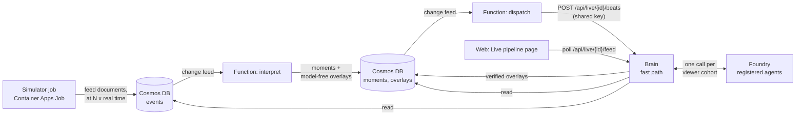

# The live pipeline

A simulated match is played as a live feed. Each event is stored, interpreted by an event-driven Function, explained by the agents and shown in the
browser while the match is still being played. Open the **Live pipeline** page of the web app (`#/live`), press **Start a live match** and watch it.

| Stage | Where | Code | What it does |
|---|---|---|---|
| **Feed** | Container Apps Job `caj-<env>-sim` | `live/simulator.py`, `live/feed.py` | Simulates the scenario (seconds), stamps every document with its arrival time (`arrivalMs`, the order the interpreter has always assumed) and releases the documents into Cosmos DB at `speed` times real time. A late start (`--from-minute`) writes the part already played at once. |
| **Interpret** | Azure Function `interpret` (Cosmos DB change-feed trigger on `events`) | `apps/functions/function_app.py`, `live/pipeline.py` | Replays the match's documents through the interpreter in arrival order, stores the new **moments** and the overlays that need no model (facts, graphics, momentum). |
| **Dispatch** | Azure Function `dispatch` (change-feed trigger on `moments`) | `apps/functions/function_app.py` | Asks the Brain to write the narrative overlays for the new moments. |
| **Explain** | The Brain, `POST /api/live/{id}/beats` | `live/dispatch.py`, `agents/` | The same fast path as `/api/beats`: the Editor, the cache, one model call per viewer cohort, the Verifier, the template fallback. Overlays are stored in Cosmos DB. |
| **Show** | The Brain's read API and the web page | `live/api.py`, `web/src/components/LivePage.tsx` | `GET /api/live`, `/api/live/{id}` and `/api/live/{id}/feed`; the page polls the feed about once a second. |

## Why it is built this way

* **Both stages are stateless and idempotent.** The interpreter is deterministic, so the `interpret` Function replays the match from the store on every
  invocation and gets the same moments; moments and overlays are created only if absent. A change feed delivers at least once, the Brain scales to zero and may be
  asleep for the first attempt (the dispatcher retries), and the job may be restarted: none of that can duplicate or lose an overlay. The Functions keep no state,
  so they scale to zero too.
* **The live and the batch pipeline are the same code.** `tests/test_live.py` checks that interpreting the live feed finds exactly the moments the batch pipeline
  finds on the same match, that interpretation can run while the match is half played and a re-delivered batch changes nothing, and that the story budget
  (three optional beats in ten minutes) is shared across dispatches.
* **Narrative overlays are written by the Brain, not by a Function**: the Brain already holds the agents, the cache and the Foundry connection, and a model call
  is I/O, not compute. The Function only decides *when*.
* **The job runs the Brain's image** with another command, so the simulator, the interpreter and the agents are one code base.

## Speed and delay

`LIVE_SPEED` (default 5) is the number of match seconds per real second. A match of 95 minutes then takes 19 minutes; starting at minute 50 takes 9. The delay
between a moment happening and its story being stored is real time, so in match time it is multiplied by the speed: that is why the default is 5 and not 60.
Measured on Azure with `gpt-6-luna` through the registered agents: see "Measured" below.

## Using it

* In the web app: **Live pipeline** in the header of the match center, or `#/live`. Pick a scenario and a start time, press **Start a live match**. The Brain
  starts the job through Azure Resource Manager with its own identity (Contributor on that one job and nothing else). One live match runs at a time: a visitor
  who arrives meanwhile is shown the running match instead.
* Over HTTP (see [brain-api.md](brain-api.md#live-pipeline)): `POST /api/live/start`, then poll `GET /api/live/{id}/feed`.
* On a laptop, without Azure: `uv run python -m matchmind.live.simulator --scenario red-card-drama --speed 50` plays the feed into memory and prints what it did; with
  `MATCHMIND_LIVE_LOCAL=1` the Brain's start endpoint runs the simulator in a thread of the same process. The Functions are not part of a local run (the interpreter
  and the dispatcher are tested against an in-memory store instead, `tests/test_live.py`).
* Starting the job by hand: `az containerapp job start -g rg-matchmind -n caj-matchmind-sim` (it uses the scenario and speed set in the job; the Brain's endpoint
  overrides them per match).

## Protection

* `POST /api/live/start` is public but limited: three starts a minute per client, one live match at a time, scenarios from a fixed list, a start minute between 0 and 80.
  A job that was asked for and never began playing stops holding the slot after ten minutes, and a failed start releases it at once.
* `POST /api/live/{id}/beats` spends model tokens, so it needs the shared key (`x-live-key`, `MATCHMIND_LIVE_KEY`, set on the Brain and on the Function app) and
  **fails closed**: with no key configured nobody gets in, unless `MATCHMIND_LIVE_OPEN=1` marks a development machine.
* The read endpoints are limited to 240 requests a minute per client (a viewer polls about 60).

## Measured

Filled in below from the deployed pipeline (October 2026).

## What is not built

* **Tracking chunks to Blob Storage and an Event Grid-triggered physical analyzer.** The simulator job computes the physical facts (sprints, top speed, distance) with the same
  analyzer as the batch pipeline and writes them into the feed as documents. The plan has the chunks land in Blob Storage and an Event Grid trigger run the analyzer;
  that hop is not built.
* **SignalR push.** The page polls once a second instead; the SignalR service stays provisioned but unused.
* **The 3D pitch in live mode.** The live page shows the pipeline (scoreboard, stages, overlays, events, moments); the pitch and the tracking playback are in the replay
  match center, which plays the same overlays from a recorded package.
