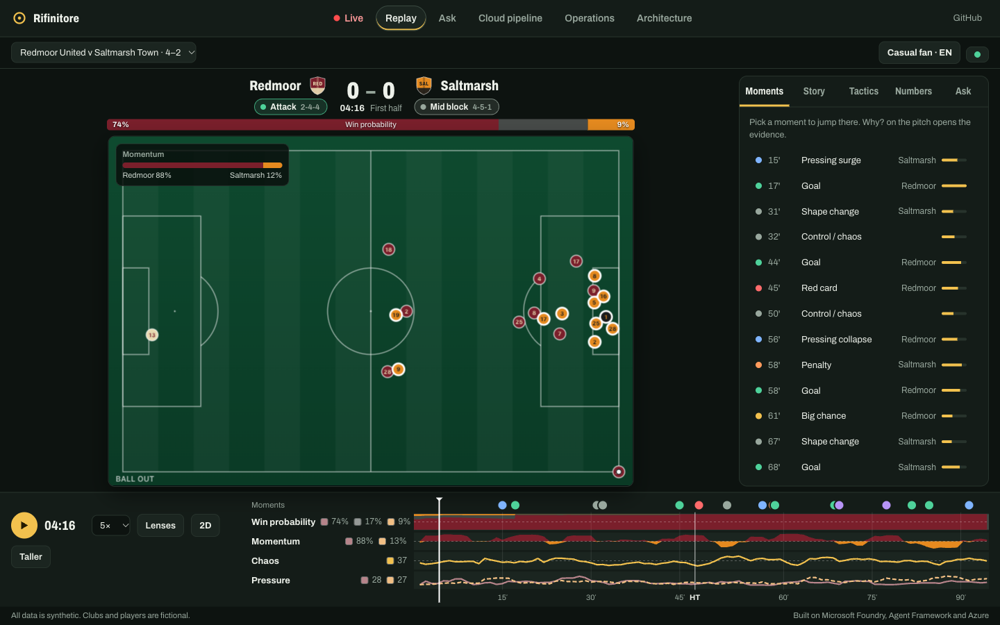
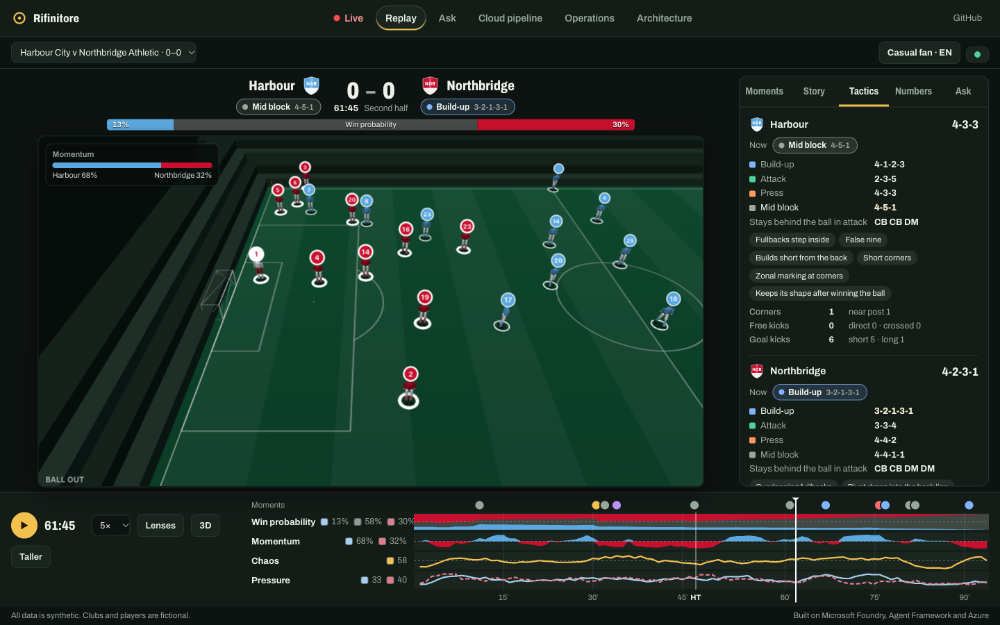

# Formations, tactics and set pieces

Football is not eleven players holding one shape. Teams change shape with the ball, play the same
formation in different ways, and rehearse their restarts. The simulator models all three, so the
tracking data the pipeline reads looks like modern European football instead of one stretched 4-4-2.

## Formations and the shapes they become

Nine formations are defined in [`src/matchmind/sim/tactics.py`](../src/matchmind/sim/tactics.py). Each has
three layouts for its ten outfield players: the nominal **base** (kick-offs, the team sheet), an
**attacking** shape and a defensive **block**. A team glides between the two (about 2.5 seconds) as
possession changes hands, so a 3-4-3 really does become a 5-4-1 when it loses the ball.

| Formation | Out of possession | In possession | Character |
|---|---|---|---|
| 4-3-3 | 4-5-1 | 2-3-5 | front three, one pivot, two eights |
| 4-2-3-1 | 4-4-1-1 | 2-4-4 | double pivot, a ten behind one striker |
| 4-4-2 | 4-4-2 | 2-4-4 | two banks of four, a strike pair |
| 4-1-4-1 | 4-5-1 | 2-3-5 | a lone holding midfielder screening the back four |
| 4-3-1-2 | 4-3-1-2 | 2-3-3-2 | a midfield diamond and two strikers |
| 3-5-2 | 5-3-2 | 3-3-4 | three centre-backs, wing-backs, two strikers |
| 3-4-3 | 5-4-1 | 3-2-5 | back three, wing-backs, a front three |
| 3-4-2-1 | 5-4-1 | 3-2-4-1 | back three, two tens in the half-spaces |
| 5-3-2 | 5-3-2 | 3-3-4 | a back five and a counter-attacking pair |

How far a team drops into its block depends on its pressing: a club that presses high keeps its nominal
front line out of possession, a club that defends deep commits fully to the block.

Measured from the tracking of simulated matches (average attack-frame position of each starter over three
matches per club; "with the ball" is when a player of that team is the one nearest the ball), clubs look different.
Kestrel Vale's wing-backs stand about 8 m higher up the pitch with the ball than without it, and 9 m from the
touchline with it against 15 m without. Harbour's inverted fullbacks stand about 19 m from the touchline while
Redmoor's overlapping ones stand 9 m from it. Harbour's false nine averages 59 m from his own goal with the ball
against 65 m for Redmoor's strikers.

**The team is a unit around the ball** (`shape.py`). Four behaviours sit on top of the formation, so a shape is not
pinned to the pitch: the whole shape slides toward the ball's flank (smoothed over about three seconds, so a team
slides rather than darts); players near the ball lean toward it, which gives the carrier short options and overloads
one flank, while wide players keep their width; the far-side wide players tuck in; and players near the ball step
off their formation spot to a nearby open one (away from opponents, with a clear line to the ball, within passing
range). Measured over four matches before and after: the team's centre follows the ball's flank by 30% (was 20%)
with the ball and 34% (was 27%) without it; the ball side holds 1.7 more outfield players than an even split (was
1.1); the far-side wide player stands 16 m from the touchline (was 11 m); in build-up both wide players are on a
touchline at once 6% of the time (was 21%); passes over 30 m are 13% of all passes (was 21%). Team width with the ball
is 49 m and length 39 m; without it 41 m and 33 m. The league realism bands still hold ([data-card.md](data-card.md)),
which needed four calibration changes: a lower cap on the team's length in possession, a heavier clearance weight, a
higher offside rate and a slightly higher chance that a failed pass runs out of play.

## How a shape is played: tactic tags

On top of the formation, a club has tags (`Style` in `teams.py`). A tag changes the attacking layout and
how restarts are taken:

| Tag | Values | Effect |
|---|---|---|
| `fullbacks` | hold, overlap, inverted | overlapping fullbacks push to the touchline while the winger tucks in; inverted fullbacks step into midfield while the winger holds the line |
| `pivot` | stay, drop | the lone holding midfielder drops between the centre-backs to build with a back three |
| `striker` | target, false9 | a false nine drops into midfield and the wingers attack the space behind |
| `build_up` | short, mixed, long | goal kicks and restarts: build from the back or go long to a target man |
| `corners` | mixed, near, far, short, edge | the attacking corner routine the club prefers |
| `corner_defence` | zonal, man, mixed | how the club defends corners |
| `long_throws` | true, false | a throw-in specialist hurls it into the box |

The six clubs of the Lumen League are archetypes (fictional, like everything else): Harbour City play
positional football from a 4-3-3 with inverted fullbacks, a false nine, short goal kicks and short
corners; Northbridge Athletic press and counter from a 4-2-3-1 with overlapping fullbacks and man-marked
corners; Redmoor United are direct and physical in a 4-4-2 with long goal kicks, far-post corners and a
long throw; Kestrel Vale use a 3-4-3 with wing-backs for width; Aldergate Rovers defend in a 5-3-2 low
block and break; Saltmarsh Town build from a dropping pivot in a 4-1-4-1.

Managers change shape mid-match ([`manager.py`](../src/matchmind/sim/manager.py)); nothing is scripted. Each manager has a
temperament drawn once from a random stream of its own (how readily he acts, and the minute from which he will chase a
deficit or protect a lead), then looks at the match every twenty seconds and sees only what a touchline sees: the score,
the clock, the numbers on the pitch and how drained his players look. The reactions are a coach's:

| Trigger | Reaction |
|---|---|
| A man down | after a minute or two, a more compact formation, a lower line and an easier press |
| The other side has a man down | a higher line, more press and width, sometimes a more attacking shape |
| Losing late (from about 58-74') | line up, press harder, more direct, a more attacking formation |
| Winning late (from about 66-80') | line down, press less, break on the counter, a more defensive formation |
| A pressing side's four most tired players are drained (from 55') | stops pressing high |

Players are re-assigned to the new slots by role fit; a sent-off player's slot goes to the most advanced role, so ten men
give up a forward. A manager makes at most three changes and none after the 86th minute. Because the stream is separate,
a match is identical to what it would have been without managers until the first reaction, and the same seed always
gives the same managers. Style changes emit no event (the pipeline has to see them in the tracking); a change of formation
emits `formation_change`. The demo matches are seeds chosen for what the managers did with them: `uv run matchmind
pick-demos HAR NOR --seeds 1-100` lists, for each seed, the score, the cards and every reaction.

## Set pieces ([`setpieces.py`](../src/matchmind/sim/setpieces.py))

When play stops, both teams walk to a *plan* for that restart, made from the club's tags and written in
the taking team's attack frame.

| Restart | Routines | Positions |
|---|---|---|
| Corner | near post, far post, short, edge of the box | two centre-backs and four attackers in or at the box, the rest left upfield as a counter-attack screen; zonal defence (a line on the six-yard box, two on the posts, one at the penalty spot) or man-marking, with two defenders upfield either way |
| Free kick | direct, crossed, quick | direct: a wall of three to five at 9.5 m, the keeper covering the open post, a decoy over the ball and rebound hunters; crossed: attackers in the box against an offside line |
| Goal kick | short, long | short: centre-backs split wide inside the box, fullbacks to the touchline, the pivot between the lines, while the opposition presses to the edge of the box (never inside it); long: the team pushes up around a target man |
| Throw-in | short, long | three outlets (short, diagonal, back) that the opponent marks; a long-throw club crowds the box |
| Penalty | | everyone else outside the box and the arc |
| Kick-off | | both teams in their own halves, the defending team outside the centre circle |

Every routine is recorded on the event (`corner.attributes.routine`, `free_kick.attributes.wall` ...) the
way a data provider tags set pieces, shown as a small card in each viewer's language, and counted per
team in the match center's Tactics tab (Understand step).

## What it cost, and what it taught

* **Realism had to be re-calibrated.** More attacking shapes raised shots and corners and lowered
  duels, fouls and pass completion; shot weighting, pressure and duel rates and pass choice were retuned
  until all 19 league averages were back in band (see [data-card.md](data-card.md)).
* **Shape changes tripped the tactical-shift detector.** It fired 5.9 times a match (it was 2.5), because
  a team's defensive line legitimately sits higher or deeper with the ball. The analyzer now samples
  defensive shape only while the opponent has the ball in the middle of the pitch, and the thresholds were
  re-derived from data (line change at least 7 m, width at least 10 m): about 0.7 false alarms a match,
  and an injected line change is found in 20 of 20 seeds (re-measured with the managers). See [metrics.md](metrics.md).
* **A latent template bug surfaced.** Claims were linked to evidence by number coincidence, so a 0.3 in one
  sentence could cite an unrelated metric that also read 0.3. A metric now counts as cited only when both
  its before and after values appear.
* **Two views of a formation.** The tactics view names a team's shape from the layout the simulator was given; the analytics
  *measure* it back from the tracking frames (`analytics/measured_shape.py`, see [analytics.md](analytics.md)). The two agree
  when the team plays to its layout and differ when it does not, which is the point of measuring.
* **Not done:** showing the set-piece card before the kick instead of as it is taken.
