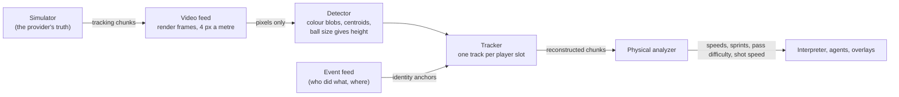

# Auto-eventing from video

The challenge asks for "a model over an incoming video feed to generate the pass and speed metrics automatically, rather than tagging them by hand". No footage is
provided, so MatchMind makes its own feed and reads it the way a studio would meet one: video in, metrics out. A live match runs this stage for real.

## What each part does (`src/matchmind/vision/`)

* **Render** (`render.py`). A top-down frame from tracking: pitch, lines, players in team colours (anti-aliased discs about a metre wide), the ball (drawn bigger
  the higher it is, as a camera sees it), camera noise and a little colour drift. Pixel and pitch coordinates are a plain scaling, so the pitch lines are there for a
  homography if the camera were not top-down. This is the stand-in for the video provider; nothing downstream sees the simulator's numbers.
* **Detect** (`detect.py`). Per frame, from the pixels alone: a colour mask per team and for the ball, connected blobs, a centroid per blob. A blob with
  about two players' worth of pixels is split with k-means. The ball's apparent size gives its height. About 2 ms a frame.
* **Track** (`track.py`). One track per player slot. Detections of a team are matched to its tracks with the Hungarian algorithm (gated by what a player can run in
  a frame) and a *role prior* (where a player usually stands relative to his team) to break ties when two cross. A track that is not seen is carried on its velocity
  for a second and then let go (a sending-off is simply a track that does not come back); a detection nobody claims is given to a lost track. The tracker starts from
  the line-up at kick-off, as a production tracker starts from a team sheet. When the **event feed** says who did something and where, and another track is
  there, the two tracks swap identities: events anchor *who is who*.
* **Feed** (`feed.py`). One per live match. Chunks published by the match player are rendered, detected, tracked and re-published as tracking chunks in the video
  feed's own store; the physical analyzer reads that store. A viewer who joins mid-match gets the earlier chunks from the provider's archive and the video model from
  the join point.
* **Preview** (`GET /api/stream/{id}/vision/frame?atMs=`, the *Video feed* card on a live match). The frame at the viewer's position with every detection boxed,
  and the running error figures.

## How good it is

Measured against the simulator's truth (`matchmind vision-eval <demo>`), whole matches of 5 Hz tracking:

| Match | Player position error (RMS) | Ball position error (RMS) | Player speed error | Ball speed error | Ball seen | Players kept as themselves |
|---|---|---|---|---|---|---|
{{TABLE}}

* **Position and speed are what the metrics need and they are close**: a few centimetres, about a kilometre an hour.
* **Who is who is the weak spot**, and it is honest to say so. Two simulated players can stand 0.1 to 0.4 m apart, which from above is one blob; when they separate
  the tracker can swap them. The event feed (a pass, a shot, a tackle names the player and the place) corrects most swaps; the rest is shown as the last column. The facts that
  name a player (a sprint, the fastest runner) can therefore be wrong about *which* player; facts about the ball, the team and the moment are not affected.
* **Cost.** About 5 ms a frame, so a 5-second chunk takes about 0.14 s of one core: a match at 10 times real time uses about a quarter of a core for the video
  stage. It runs in its own thread, in order, and the analyzer simply waits for the next chunk.

## What this is not

* It is a *synthetic* video feed made from tracking, with a deliberately simple look (top-down, flat colours), not broadcast footage; a production system would
  need a detector trained on real frames and a camera model. The stages and the interface (video in, tracking chunks out) are the ones that would stay.
* The ball's height is estimated from its apparent size, which is a crude stand-in for a real height measurement.
* "Ball in play" is taken from the event feed, not from the video.
* The tracker is told the line-up and the starting positions when a match (or a viewer's join point) begins.
